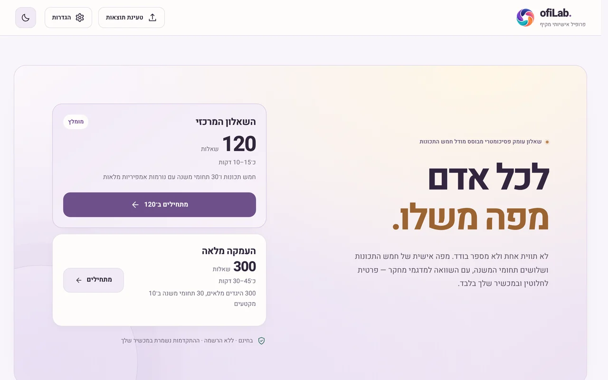
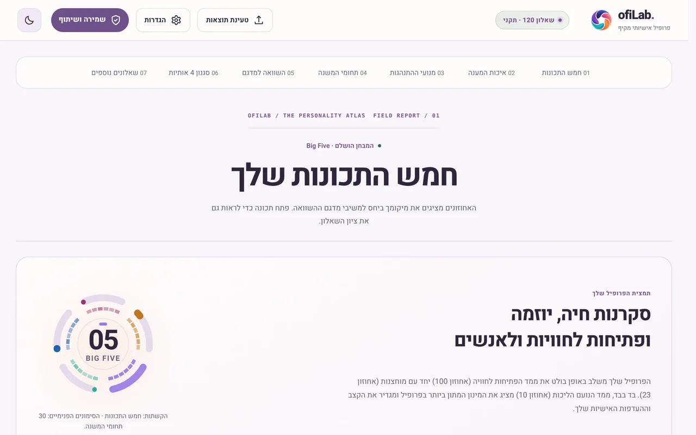
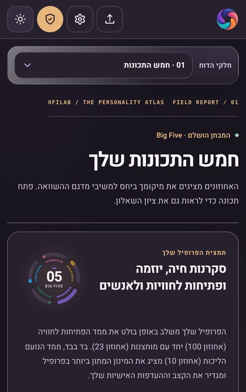

<div align="center">

# ofiLab

**מפת אישיות מבוססת Big Five, בעברית, שרצה כולה בדפדפן**

שאלוני IPIP-NEO-120 ו־IPIP-NEO-300 · השוואה למדגמים של מאות אלפי משיבים · בלי הרשמה ובלי שרת שרואה את התשובות

[האתר החי](https://ofilab.avrahamd.ovh/) · [הפעלה](#הפעלה) · [מבנה הקבצים](#מבנה-הקבצים) · [רישיון](#רישיון) · [English](#english)



</div>

## מה זה

ofiLab הוא אתר שאלוני אישיות לפי מודל חמשת הגורמים (Big Five). המשתמש עונה על 120 או 300 היגדים ומקבל דוח מפורט:
- **חמש התכונות ו־30 תחומי המשנה**, כל אחד מהם גם כציון 0–100 וגם כאחוזון מול מדגם אמיתי: 410,376 משיבים בשאלון 120, ו־145,388 בשאלון 300.
- **טווח סמך** לכל ציון, מבוסס IRT.
- **בדיקות איכות מענה**, ופירושים בעברית.

כל החישוב נעשה בדפדפן של המשתמש. השרת רק מגיש את הדפים: הוא לא מקבל את התשובות ולא שומר אותן.

> **חשוב:** זהו כלי להיכרות עצמית, לא אבחון פסיכולוגי. התרגומים לעברית ניסיוניים ולא עברו תיקוף פסיכומטרי מלא.

<div align="center">

&nbsp;

</div>

## יכולות

| | |
| --- | --- |
| **שאלונים** | IPIP-NEO-120 (כ־10–15 דקות) או IPIP-NEO-300 (כ־30–45 דקות). מי שסיים 120 יכול להמשיך ל־300 עם התשובות שכבר נתן. |
| **ציונים** | ציון 0–100 ואחוזון לכל תכונה ולכל תחום משנה, עם טווח סמך (IRT GRM לתחומי המשנה). |
| **איכות המענה** | זיהוי מענה אחיד, מענה אקראי והטיית הסכמה, ובדיקת עקביות פנימית. כשאיכות המענה נמוכה, הפירושים לא מוצגים. |
| **מודלים נוספים** | מודל קיברנטי (DeYoung), UPPS, מעגל בין־אישי, גרפי סגנון, אומדן ארבע אותיות (לא אבחון MBTI). |
| **שאלונים משלימים** | כנות וענווה (HEXACO-H), חוזקות אופי (בהשראת IPIP-VIA-R), סגנון היקשרות (ECR-RS). |
| **שמירה** | קישור שמירה, קישור מוצפן בסיסמה, קוד QR, קובץ תוצאות שאפשר לטעון מחדש. |
| **ייצוא** | דוח טקסט מלא או מקוצר, PDF, קובץ JSON, גיבוי של כל התשובות, כרטיס שיתוף. |
| **נגישות ותצוגה** | מצב בהיר וכהה, טלפון ומחשב, ניווט מקלדת, כיבוד „הפחתת תנועה”. |
| **עוזר AI** | אופציונלי וכבוי כברירת מחדל ([הפעלה](#עוזר-ai-אופציונלי)). |

## הפעלה

**דרישות:** PHP 8 ומעלה (נבדק על 8.3). אין שלב בנייה, אין מסד נתונים ואין תלויות להתקנה.

**מקומית:**

```bash
git clone https://github.com/avraham-d/OfiLab.git
cd ofilab
php -S 127.0.0.1:8765
# http://127.0.0.1:8765/index.php
```

**בשרת:** מעלים את התיקייה כמו שהיא לכל שרת שמריץ PHP (Apache, Nginx עם PHP-FPM וכו').

ההצפנה בסיסמה וההעתקה ללוח דורשות כתובת **HTTPS**, כי הדפדפן מאפשר אותן רק בחיבור מאובטח (או ב־localhost). שאר האתר עובד גם בלי.

## מבנה הקבצים

```
ofilab/
├── index.php                  העמוד הראשי: השאלון, התוצאות וכל החלונות. משבץ את קובצי השאלות מ־data/
├── about.html                 הסבר על השיטה, המדגמים והמגבלות
├── favicon.ico
├── ai-config.example.php      דוגמה להפעלת עוזר ה־AI (ראו בהמשך)
│
├── data/                      הקבצים שהאתר קורא
│   ├── ipip-neo-120-he.json          120 ההיגדים: עברית, המקור באנגלית, תחום משנה וכיוון ניקוד
│   ├── ipip-neo-300-he.json          300 ההיגדים, באותו מבנה
│   ├── question-guidance-he.json     הסבר לכל שאלה ב־120 (כפתור „?” ליד השאלה)
│   ├── question-guidance-300-he.json הסבר לכל שאלה ב־300
│   ├── hexaco-h-16-he.json           שאלון כנות וענווה (16 היגדים)
│   ├── ipip-via-r-60-he.json         שאלון חוזקות אופי (60 היגדים)
│   ├── ecrrs-he.json                 שאלון היקשרות (9 היגדים)
│   ├── empirical-norms.json          טבלאות השכיחות של מדגם 120, להורדה ולבדיקה
│   └── empirical-norms-300.json      טבלאות השכיחות של מדגם 300
│
└── assets/
    ├── personality.js             הבקר הראשי: מהלך השאלון, שמירה, מעבר בין 120 ל־300, הצגת התוצאות
    ├── scoring.js                 מנוע הניקוד של שאלון 120
    ├── scoring-300.js             מנוע הניקוד של שאלון 300
    ├── empirical-norms.js         אחוזונים, טווחי סמך ותובנות מול המדגם
    ├── experience.js              דף התוצאות: תחומי משנה, תמצית, ניווט והגדרות
    ├── experience-validity.js     בדיקות איכות המענה
    ├── experience-models.js       המודלים הנוספים (קיברנטי, UPPS, מעגל בין־אישי, גרפי סגנון)
    ├── experience-quizzes.js      שלושת השאלונים המשלימים
    ├── four-letter-estimate.js    אומדן ארבע אותיות
    ├── profile-executive.js       תמצית הפרופיל במילים
    ├── profile-links.js           זיהוי תחומי משנה שנפרדים מהדפוס הרגיל
    ├── hexaco-codec.js · via-codec.js · ecrrs-codec.js   ניקוד ושמירה של השאלונים המשלימים
    │
    ├── storage.js                 שמירת ההתקדמות במכשיר (localStorage ו־IndexedDB)
    ├── compact-codec-small.js     קידוד קישור השמירה של 120
    ├── compact-codec.js           קידוד קישור השמירה של 300
    ├── codec-dispatch.js          בחירת הקידוד לפי השאלון
    ├── secure-save.js             הצפנה בסיסמה (AES-256-GCM, Argon2id)
    ├── argon2-worker.js           גזירת המפתח ב־Web Worker
    ├── argon2.umd.min.js          ספריית hash-wasm (צד שלישי)
    ├── password-strength.js       מד חוזק הסיסמה
    ├── protected-link-routing.js  זיהוי השאלון מתוך קישור מוצפן
    ├── results-files.js           קובץ התוצאות: הורדה וטעינה מחדש
    ├── results-share-link.js      קוד QR ושיתוף
    ├── qrcode-generator.js        יצירת QR (צד שלישי)
    ├── export-markdown.js         הדוחות בטקסט
    ├── visuals.js                 PDF וכרטיס השיתוף
    ├── extended-journey.js        חלוקת שאלון 300 לפרקים
    ├── ai-chat.js · chat-markdown.js   עוזר ה־AI והצגת תשובותיו
    ├── theme.js                   מצב בהיר וכהה
    │
    ├── empirical-data.js          ┐ נתונים מצטברים שנגזרו מנתוני המקור:
    ├── empirical-data-300.js      │ טבלאות שכיחות, פרמטרים של מודלים וטווחי סמך.
    ├── empirical-deep-models.js   │ אין בהם רשומות של משיבים. הם נוצרו בכלי המחקר
    ├── irt-facet-score-ci.js      │ של מאגר הפיתוח, ולכן כמה הערות בתוכם מזכירות
    ├── profile-links-data.js      ┘ קבצים שלא נכללו כאן.
    │
    ├── ofilab-structural.css      שכבת הבסיס: פריסה, הדפסה ונגישות
    ├── calm.css · calm.identity.css   העיצוב (גוברים על שכבת הבסיס)
    ├── calm.about.css             עיצוב דף ההסבר
    ├── report-print.css           עיצוב ה־PDF
    ├── calm-components.js · calm-lens.js   הגרפים: מפת התכונות ועדשת הפרופיל
    ├── fonts/                     הגופן Heebo ורישיונו
    ├── logo-mark.png · favicon.svg
    └── LICENSE-hash-wasm.txt · qrcode-generator.LICENSE.txt   רישיונות צד שלישי
```

**הקוד בלי שלב בנייה:**
- `index.php` טוען את הקבצים מ־`assets/` לפי סדר קבוע.
- כל קובץ JavaScript הוא מודול עצמאי שמוסיף את מה שלו ל־`window`.
- כדי לשנות משהו עורכים את הקובץ ומרעננים את הדף.

## עוזר AI (אופציונלי)

העוזר מסביר שאלות ותוצאות בשיחה. הוא דורש שרת משלכם שמדבר עם מודל שפה, ולכן הוא כבוי כברירת מחדל: בלי הגדרה כל כפתורי ה־AI מוסתרים ושום מידע לא נשלח.

להפעלה:
1. מעתיקים את `ai-config.example.php` ל־`ai-config.php` (הקובץ מוחרג מ־git).
2. כותבים בו את הנתיב של נקודת הקצה שלכם, באותו דומיין של האתר, למשל `/api/ofilab-chat.php`.
3. בנקודת הקצה קוראים את מפתח המודל ממשתני הסביבה של השרת. **לעולם לא שמים מפתחות בקובצי האתר.**

פורמט הבקשה והתשובה (JSON או Server-Sent Events) מתואר בקובץ `ai-config.example.php`.

## פרטיות ואבטחה

- **התשובות לא יוצאות מהמכשיר:** הן נשמרות בדפדפן או בקישור השמירה. מה שאחרי `#` בכתובת לא נשלח לשרת.
- **קישור `#p=`** אינו מוצפן: כל מי שמחזיק בו יכול לקרוא את התשובות.
- **קישור `#e=`** מוצפן בסיסמה. הסיסמה לא נשמרת בשום מקום, ואין דרך לאפס אותה.
- **עוזר ה־AI**, אם הופעל, מקבל את מה שהמשתמש כותב בשיחה ואת הציונים המחושבים, אבל לא את התשובות הגולמיות.
- **תשובות המודל** מוצגות כטקסט בטוח, בלי הרצת HTML.
- **מצוקה רגשית:** כשמדדי הדכדוך או הפגיעות גבוהים מאוד, מופיעה הפניה עדינה לער"ן ולסה"ר.

## מקורות

- **ההיגדים:** International Personality Item Pool (IPIP), נחלת הכלל. IPIP-NEO-120 של Johnson (2014), ו־IPIP-NEO-300 לפי המפתח של Goldberg.
- **המדגמים:** הארכיון של Johnson (שאלון 120, N=410,376) ונתוני IPIP-NEO-300 (N=145,388). באתר נשמרות רק ספירות מצטברות.
- כל המקורות והרכיבים של צד שלישי, עם הרישיונות שלהם: [THIRD_PARTY_LICENSES.txt](THIRD_PARTY_LICENSES.txt).

## רישיון

ofiLab ניתן **לשימוש חופשי לטובת אנשים, ולא למטרת רווח**, לפי [רישיון הקהילה של ofiLab](LICENSE). הרישיון חל על הקוד ועל התוכן בעברית.

**מותר, בחינם:**
- שימוש אישי, מחקר והוראה, גם במוסד לימודים שגובה שכר לימוד, כל עוד לא גובים תשלום על השאלון או על התוצאות.
- שימוש בעמותות, בגופים ציבוריים ובארגוני צדקה.
- שימוש של איש מקצוע (פסיכולוג, יועץ, מאמן) עם הלקוחות שלו, כל עוד הלקוח לא משלם על השאלון, על התוצאות או על הדוח.
- שינוי הקוד והפעלת גרסה משלכם.

**התנאים:**
- **אסור שום הכנסה** מהאתר או מגרסה שלו: לא תשלום, לא מנוי, לא פרסומות, לא חסויות, לא בקשת תרומות דרכו ולא מכירת נתונים.
- **קרדיט גלוי** בכל גרסה שאחרים משתמשים בה: „Based on ofiLab by Avraham David”, עם קישור לאתר המקורי.
- **שיתוף שינויים:** מי שמפעיל או מפיץ גרסה משונה חייב לפרסם את הקוד המלא שלה בחינם, באותו רישיון.
- **שם ולוגו:** גרסה משלכם צריכה שם ומיתוג משלה. אסור להשתמש בשם ofiLab ובלוגו.

**אסור:**
- **החלטות על אנשים בעבודה:** גיוס, מיון, קידום, הערכה או פיטורים. מעסיק רשאי להציע לעובדים להשתמש באתר להיכרות עצמית בלבד, ורק אם התוצאות לא מגיעות אליו.
- **אימון מודלי AI מסחריים:** אסור לאמן בעזרת הקוד והתוכן מודל AI שנמכר או משמש במוצר מסחרי. מחקר לא מסחרי מותר.

**לא כלולים ברישיון:**
- ההיגדים המקוריים באנגלית (IPIP), שהם נחלת הכלל.
- רכיבי צד שלישי, שנשארים ברישיונות שלהם ([THIRD_PARTY_LICENSES.txt](THIRD_PARTY_LICENSES.txt)).

לבקשת אישור לשימוש אחר, כולל שימוש מסחרי: [פתחו issue](https://github.com/avraham-d/OfiLab/issues).

---

<div dir="ltr">

## English

**ofiLab** is a Hebrew Big Five personality site that runs entirely in the browser.

**What it offers:**
- The IPIP-NEO-120 and IPIP-NEO-300 questionnaires.
- 0–100 scores and empirical percentiles for 5 domains and 30 facets, against N=410,376 and N=145,388 respondents.
- IRT-based confidence intervals and response-validity checks.
- Supplementary questionnaires: Honesty-Humility (HEXACO model), character strengths (inspired by IPIP-VIA-R) and ECR-RS.
- Encrypted save links and full exports: text, PDF, JSON and a share card.

No accounts, no database, and answers never reach the server.

- **Run:** PHP 8+, no build step and no dependencies. Locally: `php -S 127.0.0.1:8765`, then open `/index.php`. Serve over HTTPS in production, because password encryption and the clipboard need a secure context.
- **Layout:**
  - `index.php`: the app.
  - `data/`: items, explanations and norm tables.
  - `assets/`: plain JavaScript modules and CSS, loaded in order by `index.php`.
- **AI assistant:** optional and off by default. Copy `ai-config.example.php` to `ai-config.php`, point it at your own same-origin endpoint, and keep API keys on the server.
- **Limitations:** the Hebrew item translations are experimental. This is a self-exploration tool, not a diagnostic instrument.
- **License:** [ofiLab Community License](LICENSE). Free for the benefit of people, not for profit; it covers both the code and the Hebrew content.
  - **Allowed:** personal use, research, teaching (including at tuition-charging institutions), nonprofits and public bodies, and professionals with their clients, as long as nobody is charged for the questionnaire or its results.
  - **No income of any kind** from the site or any version of it.
  - **Required:** a visible credit line with a link, the same license and published source for modified versions, and your own name and logo.
  - **Not allowed:** employment decisions (hiring, screening, promotion), and training commercial AI models.
  - The original English IPIP items are public domain. Other uses need written permission; open an issue to ask.

</div>
